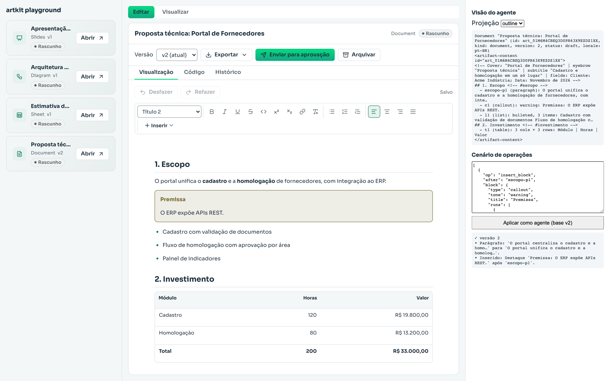
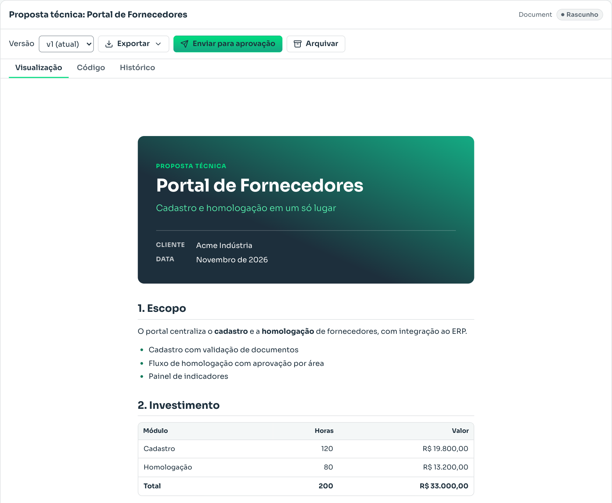
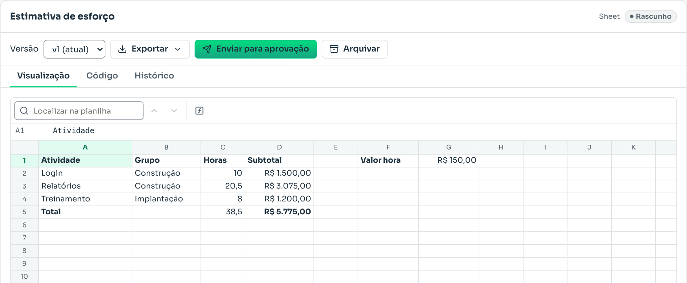
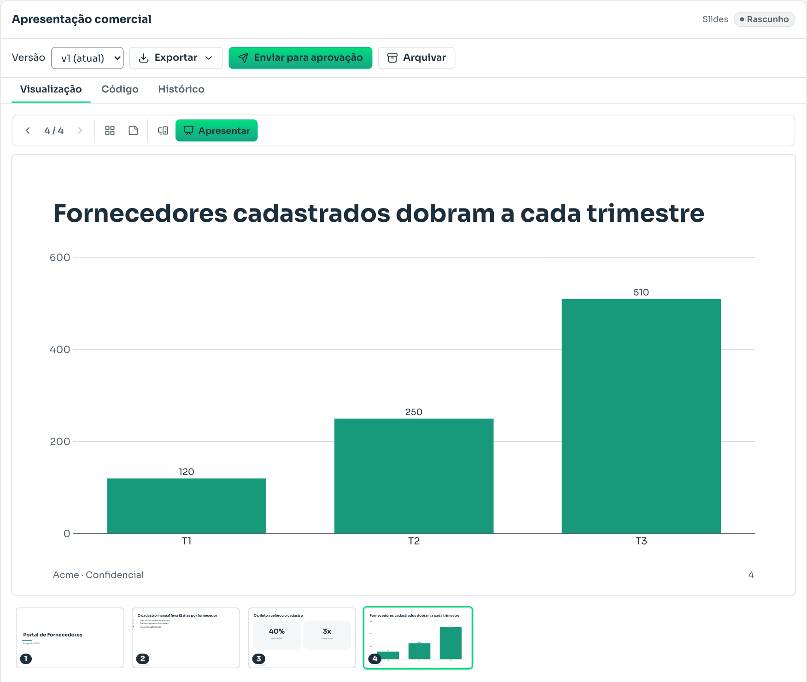
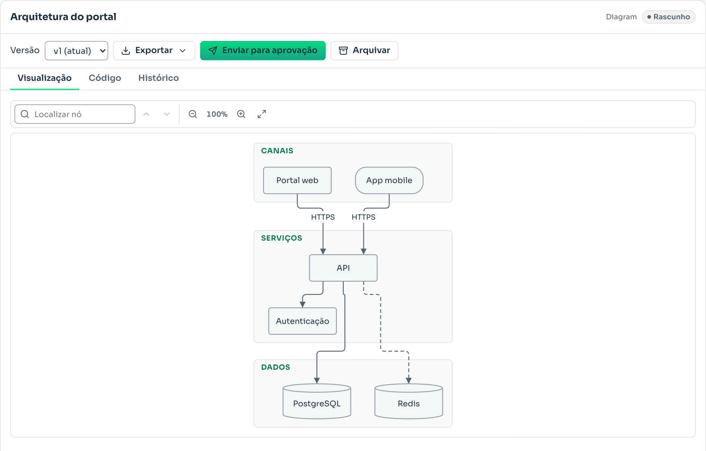

# artkit

Open-source library (Apache-2.0) for React and Node that lets AI agents **create, read, edit, render and export rich artifacts**: documents (Markdown and Word), spreadsheets with formulas, slide decks and diagrams.

- **A data standard models handle well.** Every artifact is small, typed JSON with short semantic ids. Models never write Office XML, free HTML or arbitrary coordinates unless they need to.
- **Safe, incremental editing.** Agents change artifacts through validated operations (insert a block, set cells, move a slide), applied atomically and versioned, with automatic rebase against human edits.
- **One source of truth.** The same JSON drives the React renderer, the visual editors, the text projection the model reads, and the exporters (docx, xlsx, pptx, svg, png, pdf, md, html, csv).

The specification (in Portuguese) is in [docs/spec.md](docs/spec.md); implementation conventions are in [docs/CONVENTIONS.md](docs/CONVENTIONS.md).

## What it looks like

The screenshots below come from the [browser playground](examples/playground): the same four artifacts an agent could create for a supplier-portal proposal, shown with the built-in renderers.

### An agent edits, the user sees the result



On the right is what the model reads (a compact text outline with stable ids) and the operations it sends. Here it inserted a "Premissa" callout after the `escopo-p1` paragraph and replaced one word. The engine validated the operations, created version 2 and returned a readable diff. In the middle, the user sees the change right away in the visual editor, where they can keep editing, undo, compare versions, export or send it for approval.

### Document



Created from Markdown with a cover page. Each block has an id the agent can target. Exports to **docx**, **md** and **html**.

### Sheet



Cells, styles, number formats and **formulas** (`=C2*valor_hora`, `=SUM(D2:D4)`) computed by the built-in engine, including named ranges. Exports to **xlsx**, **csv** and **html**.

### Slides



The agent picks semantic layouts (`title`, `title-content`, `big-number`…) and fills slots with text, bullets, stats, tables or **charts**. artkit handles the layout. Includes a presentation mode and native **pptx** export (plus html and md).

### Diagram



Written as Mermaid or as nodes/edges/groups. Automatic layout, shapes, labeled edges and groups. Exports to **svg** and **html**.

Every kind also exports to **png** and **pdf** through the headless renderer in [`@artkit-ai/node/headless`](packages/node). To regenerate these images after a UI change, start the playground and run `node scripts/readme-screenshots.mjs`.

## Packages

| Package                                              | What it does                                                                                                                                                                            |
| ---------------------------------------------------- | --------------------------------------------------------------------------------------------------------------------------------------------------------------------------------------- |
| [`@artkit-ai/core`](packages/core)                   | Envelope, kind contract and registry, operation engine with rebase and idempotency, versioning, migrations, diff, lint, projection, errors, store and asset contracts, artifact service |
| [`@artkit-ai/kind-document`](packages/kind-document) | Rich documents with Markdown in/out; renderer, TipTap editor, docx/md/html export                                                                                                       |
| [`@artkit-ai/kind-sheet`](packages/kind-sheet)       | Spreadsheets with a built-in formula engine; virtualized grid editor; xlsx/csv/html export                                                                                              |
| [`@artkit-ai/kind-slides`](packages/kind-slides)     | Decks with semantic layouts and free elements, tables and charts; editor; native pptx export                                                                                            |
| [`@artkit-ai/kind-diagram`](packages/kind-diagram)   | Nodes, edges and groups with Mermaid input and automatic layout; React Flow editor; svg export                                                                                          |
| [`@artkit-ai/react`](packages/react)                 | Provider, view, editor host, assistant-style panel, chat card, approval, version diff, hooks                                                                                            |
| [`@artkit-ai/node`](packages/node)                   | Filesystem stores, HTTP routes, export orchestration, headless PNG/PDF (Playwright)                                                                                                     |
| [`@artkit-ai/agent`](packages/agent)                 | Harness-neutral tools, model instructions, guides and skills generation                                                                                                                 |
| [`@artkit-ai/ai-sdk`](packages/ai-sdk)               | Vercel AI SDK 7 adapter: tools, approval, context, data parts, `useArtifacts`                                                                                                           |
| [`@artkit-ai/mcp`](packages/mcp)                     | MCP server: the same tools, artifact resources and guide prompts                                                                                                                        |
| [`@artkit-ai/skills`](packages/skills)               | Agent Skills (`artkit-artefatos`, `artkit-integracao`) generated from the schemas                                                                                                       |
| [`@artkit-ai/evals`](packages/evals)                 | Evaluation suite per kind, model, schema profile and with/without the skill                                                                                                             |

The default look is the **Mouts design system**: Sora typography (embedded, no font CDN), the institutional green and graphite, light and dark themes, 1px hairlines, no shadows and [Lucide](https://lucide.dev) icons. Apps can register their own themes (`createRegistry({ themes })`) and pass them to the React provider.

Each kind ships subpaths so apps load only what they use: `.` (model, runs in browsers, Node, edge and workers), `/react` (renderer), `/edit` (editor) and `/export` (exporters).

## Quick start

```bash
pnpm add @artkit-ai/core @artkit-ai/agent @artkit-ai/ai-sdk @artkit-ai/kind-document @artkit-ai/kind-sheet ai
```

**Agent (AI SDK 7)**

```ts
import { createArtifactToolkit } from '@artkit-ai/agent';
import {
  artifactContextSchema,
  artifactInstructions,
  artifactToolApproval,
  artifactTools,
  artifactToolsContext,
} from '@artkit-ai/ai-sdk';
import { createRegistry } from '@artkit-ai/core';
import { documentKind } from '@artkit-ai/kind-document';
import { sheetKind } from '@artkit-ai/kind-sheet';
import { createFsStore } from '@artkit-ai/node';
import { ToolLoopAgent } from 'ai';

const toolkit = createArtifactToolkit({
  registry: createRegistry({ kinds: [documentKind, sheetKind] }),
  store: createFsStore({ dir: './data' }),
  authorize: (action, artifact, scope) => canAccess(scope), // mandatory
  locale: 'pt-BR',
});
const tools = artifactTools(toolkit);

const agent = new ToolLoopAgent({
  model,
  instructions: artifactInstructions(toolkit),
  tools,
  toolApproval: artifactToolApproval(toolkit),
  callOptionsSchema: artifactContextSchema,
  // Workspace and user come from your session, never from the model's arguments.
  prepareCall: ({ options, ...settings }) => ({
    ...settings,
    toolsContext: artifactToolsContext(tools, options),
  }),
});

await agent.generate({
  prompt: 'Crie uma proposta técnica…',
  options: { workspaceId, actor: { type: 'agent', id: 'assistant' } },
});
```

**Server routes** (any fetch-standard framework, or `node:http` through `toNodeHandler`):

```ts
import { createArtifactRoutes } from '@artkit-ai/node';

const routes = createArtifactRoutes({
  service: toolkit.service,
  resolveScope: (request) => scopeFromSession(request),
});
// e.g. a Next.js catch-all route under /api/artifacts; the handler returns undefined for paths it does not own.
const handle = async (request: Request) =>
  (await routes(request)) ?? new Response('Not found', { status: 404 });
export { handle as GET, handle as POST, handle as DELETE };
```

**React panel**

```tsx
import { ArtifactPanel, ArtifactProvider, createHttpClient } from '@artkit-ai/react';

<ArtifactProvider
  registry={registry}
  client={createHttpClient({ baseUrl: '/api/artifacts' })}
  loaders={loaders}
  locale="pt-BR"
>
  <ArtifactPanel id={artifactId} permission="edit" />
</ArtifactProvider>;
```

See each package README for details, and the runnable [examples](examples): a Node script, an MCP server for desktop clients, a browser playground, a Postgres store and the migration from the Workia artifact model.

## Development

Requirements: Node 22+ and pnpm 10.

```bash
pnpm install
pnpm build                                  # tsc -b over every package
pnpm test                                   # Vitest, all packages (sources, no build needed)
pnpm vitest run packages/kind-sheet         # one package
pnpm lint                                   # Biome
pnpm verify                                 # build, typecheck examples, lint, test, dependency/license/publish/skills checks
pnpm --filter @artkit-ai/example-playground dev
```

Releases use [changesets](https://github.com/changesets/changesets): `pnpm changeset` for each publishable change; the release workflow opens a version PR and publishes to npm with provenance.

## Status

Version 0.1.0 implements phase 1 of the specification: the core, the four kinds with renderers, editors and exporters, the React, Node, agent, AI SDK, MCP, skills and evals packages. Phase 2 (sandboxed `app` kind, CLI, more kinds) and phase 3 (real-time collaboration, Office import) are not implemented. See [CONTRIBUTING.md](CONTRIBUTING.md) and [SECURITY.md](SECURITY.md).

## License

[Apache-2.0](LICENSE)
